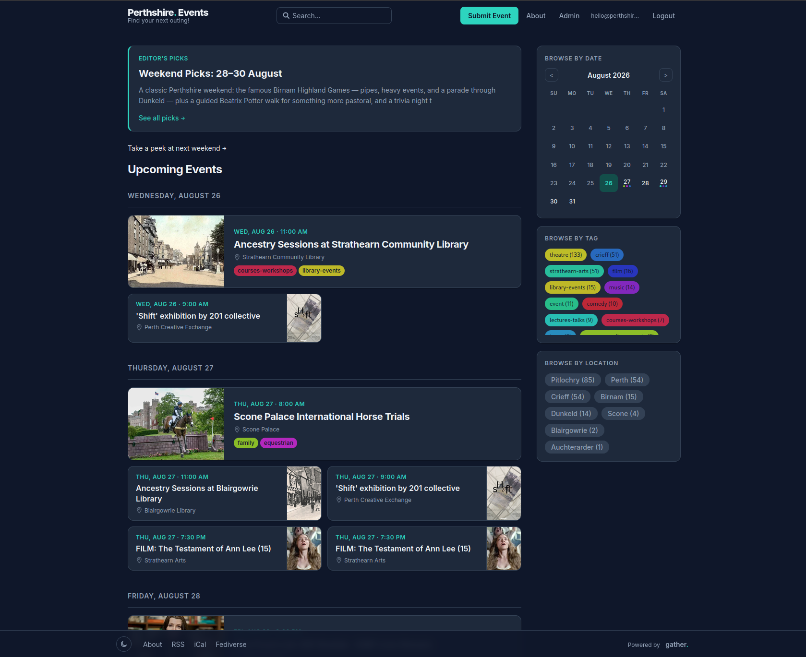

# Gather

A self-hosted community calendar. Collect, moderate, and share local events with your community.

Built with Go ([PocketBase](https://pocketbase.io)) and [Preact](https://preactjs.com). Single binary, no external dependencies.

**Live example:** [perthshire.events](https://perthshire.events)



## Features

- Event submission with optional moderation workflow
- Role-based access control (user / editor / admin)
- Recurring events with per-occurrence cancellation (RRULE)
- ActivityPub federation — follow your calendar from Mastodon and other Fediverse apps
- Mobilizon federation — events appear on [Mobilizon](https://joinmobilizon.org) instances, and Mobilizon users can follow a single venue or town
- RSS and iCal feeds (global, per-tag, per-venue, per-event)
- Location-based events with OpenStreetMap — no Google Maps
- Proximity search ("events near me")
- Real-time updates via SSE subscriptions
- Editorial Picks — curated weekly roundups with home page teaser
- Custom pages (About, FAQ, Code of Conduct) with Markdown support
- OAuth2 social login (configurable via PocketBase)
- API keys for external integrations
- Branded HTML email notifications for moderators
- Rate limiting on auth and submission endpoints
- Custom branding (name, subtitle, favicon, custom CSS, head code)
- Dark / light theme with system preference detection
- Single binary deployment with embedded frontend

## Self-Hosting

### Docker Compose (recommended)

Create a `docker-compose.yml`:

```yaml
services:
  gather:
    image: ghcr.io/grantstephens/gather:latest
    container_name: gather
    restart: unless-stopped
    ports:
      - "8090:8090"
    volumes:
      - gather_data:/app/pb_data
    environment:
      - PB_ADMIN_EMAIL=admin@example.com
      - PB_ADMIN_PASSWORD=changeme
      - BASE_URL=https://your-domain.com
      - TZ=UTC

volumes:
  gather_data:
```

```bash
docker compose up -d
```

Your instance will be available at `http://localhost:8090`.

### Docker Run

```bash
docker run -d \
  --name gather \
  -p 8090:8090 \
  -v gather-data:/app/pb_data \
  -e PB_ADMIN_EMAIL=admin@example.com \
  -e PB_ADMIN_PASSWORD=changeme \
  -e BASE_URL=https://your-domain.com \
  -e TZ=UTC \
  ghcr.io/grantstephens/gather:latest
```

### Build from Source

Requires Go 1.25+, Node.js 18+, and libwebp-dev.

```bash
git clone https://github.com/grantstephens/gather.git
cd gather
make build       # builds frontend + Go binary
./gather serve   # starts on :8090
```

## Configuration

### First-Time Setup

Gather has two separate account systems (this is a PocketBase limitation):

- **PocketBase superuser** — manages the database at `/_/`. Created from the `PB_ADMIN_EMAIL` / `PB_ADMIN_PASSWORD` env vars.
- **App user** — logs into the frontend at `/login`. You'll need to register a separate account and then promote it to admin via the PocketBase dashboard (`/_/` > Collections > users > edit the record > set role to `admin`).

Once you have a frontend admin account:

1. Log in at `/login`
2. Go to **Admin** > **Settings** to configure:
   - **Site name** and **subtitle**
   - **Favicon** (auto-converted to WebP)
   - **SEO description** for search engines and social previews
   - **Moderation** settings (anonymous submissions, require approval)
   - **ActivityPub** federation toggle
   - **OAuth2** social login providers
   - **Custom CSS** and **tracking/head code**

### Environment Variables

| Variable | Default | Description |
|----------|---------|-------------|
| `PB_ADMIN_EMAIL` | `admin@example.com` | PocketBase superuser email |
| `PB_ADMIN_PASSWORD` | `changeme` | PocketBase superuser password — change this! |
| `BASE_URL` | `http://localhost:8090` | Public URL (used for ActivityPub, feeds, emails) |
| `PB_ENCRYPTION_KEY` | _(empty)_ | Encryption key for sensitive data (`openssl rand -hex 32`) |
| `TZ` | `UTC` | Timezone for event display (e.g. `Europe/London`). Affects iCal feeds and JSON-LD dates. |

### Reverse Proxy

Gather runs on port 8090. Put it behind nginx, Caddy, or similar for HTTPS.

Example Caddy config:

```
your-domain.com {
    reverse_proxy localhost:8090
}
```

### Backups

PocketBase has built-in automated backups enabled by default. All data also lives in the `pb_data` directory (or Docker volume) — back up this directory to preserve your database and uploaded files.

### Feeds

Your instance automatically provides:

- **RSS** at `/feed.rss` (all events), `/feed/tag/{tagname}` (by tag)
- **iCal** at `/feed.ics` (all events), `/ics/tag/{tagname}` (by tag), `/ics/event/{id}` (single event)
- **ActivityPub** actor at `/ap/actor`, plus a relay and per-venue / per-town actors (see below)

### Fediverse and Mobilizon

Gather publishes events as ActivityPub. Three kinds of actor exist, each for a different audience:

| Actor | Handle | Who follows it | What they receive |
|---|---|---|---|
| Instance | `events@your-domain` | Mastodon and other Fediverse apps | Every event, as a post |
| Relay | `relay@your-domain` | A Mobilizon instance (its admin) | Every event, as a Mobilizon event, listed in Explore |
| Venue | `{venue-slug}@your-domain` | Mobilizon users | Events at that venue |
| Town | `town-{town-slug}@your-domain` | Mobilizon users | Events at any approved venue in that town |

Venue and town handles are the venue's slug (the last part of its `/place/...` URL) and `town-` plus the lower-cased, hyphenated town name (`town-pitlochry`). Only approved venues resolve, so the normal venue approval is what controls this. The actors are created the first time someone looks them up, so there is nothing to set up.

**Getting your events onto a Mobilizon instance.** Mobilizon only lists remote events that were announced by an instance it follows. A Mobilizon admin follows your instance from the *Instances* page of the admin area, entering your domain (e.g. `gather.example.org`). Once the follow shows as approved, every event you publish afterwards is sent there, including edits, cancellations (shown as cancelled) and removals. Events published before the follow are not sent.

**Following one venue or town.** On Mobilizon, search for `town-pitlochry@gather.example.org` (or a venue handle) and follow the group. Its events show on the group's page, owned by that group. Venue and town actors are built for Mobilizon; following them from Mastodon is untested and may not deliver anything, so Mastodon users should follow `events@your-domain`.

**What Mobilizon shows.** Title, description, start and end time, venue with address and map, approved tags, and the event image. Registration is external: Mobilizon links back to the Gather event page. The `Cost:` and `Source:` lines Gather adds to descriptions are removed, and a link to the Gather page is added instead, so price is not shown on Mobilizon.

**Timezone.** Set the `TZ` environment variable (e.g. `Europe/London`, the default) to the zone your events happen in, or Mobilizon will show the wrong local time.

**Timing.** Activities go through the delivery queue, which runs every 5 minutes, so allow a few minutes for changes to appear.

See [API.md](API.md#activitypub-federation) for the endpoints and the exact rules for each status change.

### Custom Pages

Create static pages (About, FAQ, Code of Conduct, etc.) from the Admin > Pages tab. Pages can appear in the navigation bar, footer, or both, and support Markdown content.

### PocketBase Admin

The PocketBase admin dashboard is available at `/_/` for direct database access, collection management, log viewing, and backup management.

## License

Licensed under the [GNU Affero General Public License v3.0](LICENSE). If you run a modified version as a network service, you must publish your source changes.
